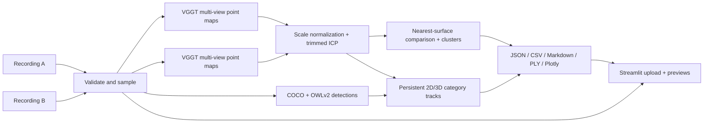

# RoomChange3D

**A local 3D scene-change system for two phone videos of the same room.** It reconstructs each clip with VGGT, aligns the scenes in a relative coordinate frame, tracks recognized object categories across sampled frames, and exports the evidence. It presents only supported `moved`, `unchanged`, `added`, and `removed` object tracks; weak or incomplete hypotheses are suppressed rather than shown as changes.

> **Model license:** the default `facebook/VGGT-1B` checkpoint is CC BY-NC 4.0 (non-commercial). The official code provides a separate `facebook/VGGT-1B-Commercial` checkpoint that requires an application. Do not use the default weights for commercial work. After obtaining access, select the commercial checkpoint with `ROOMCHANGE_VGGT_MODEL=facebook/VGGT-1B-Commercial` before launching the app. The code repository can be published. Model weights and raw local recordings are never committed; the curated sample clips under examples/ are included.

## Start on Windows

1. Install Python 3.12 x64 from [python.org](https://www.python.org/downloads/windows/) with the Python Launcher enabled, plus Git for Windows if not already present.
2. Double-click `START_HERE.bat`. It creates `.venv`, installs CUDA-enabled PyTorch 2.7.1 for CUDA 12.8 and app dependencies, downloads the official VGGT source, and checks whether CUDA inference is available. It falls back to CPU PyTorch if the CUDA wheel cannot install.
3. On first analysis, VGGT and OWLv2 download their model checkpoints through Hugging Face into the standard user cache; torchvision downloads its COCO and ImageNet weights when used. This first run needs internet access and disk space; later inference is local.
4. The browser opens at the local Streamlit address. Upload the before and after videos and press **Analyse Scene Changes**. Built-in object recognition runs automatically; extra prompts are optional.

Run `doctor.ps1` for diagnostics. Setup output is recorded in `setup.log` (ignored by Git). Generated runs go under `outputs/run_<timestamp>/` (ignored by Git).

### GPU support

The installer targets PyTorch 2.7.1 CUDA 12.8 wheels, which are the relevant wheel family for recent NVIDIA hardware. The script verifies `torch.cuda.is_available()` at the end. This workspace verified CUDA inference on an RTX 5070 Ti; a different host still depends on its driver and wheel compatibility. CUDA out-of-memory during VGGT forward triggers a CPU retry, which can be slow.

## Capture guide

- Choose a small, well-lit indoor area with distinct textured surfaces and a few recognizable objects.
- Record about 6–20 seconds while moving slowly around it. Include overlapping views of the same room from more than one position.
- Move, add, or remove a few objects. Record the same space again from different angles while retaining substantial overlap.
- For a moved object, show the old location empty and the new location, holding the camera steady on each for 2–3 seconds. Keep every changed item visible across several consecutive sampled frames.
- Keep the phone steady, avoid cuts and fast pans, and use bright even light.
- Adequate viewpoint coverage matters more than exact duration. Repetitive patterns, blank walls, reflective surfaces, motion blur, and large occlusions reduce reconstruction quality. Areas never seen in one clip cannot be compared reliably.
- H.264 MP4 is the safest input. MOV is accepted when the local OpenCV/FFmpeg build can decode its codec.

The interface checks readability, frame count, resolution, duration and sharpness before analysis. It checks up to twice as many candidates as it reconstructs and deterministically selects the sharpest frame in each time segment, preserving coverage while reducing blur. The default is 32 samples per recording. Object detection automatically checks the full COCO vocabulary plus common indoor object prompts (bag, bottle, laptop, chair, table, sofa, bed, book, remote, phone, footwear and more). Bag recognition also checks backpack, handbag and rucksack descriptions. The optional prompt field adds categories beyond this built-in set; it can be left blank. If selected frames remain soft, it warns that missing detail cannot be recovered by sharpening and withholds event labels; record a steadier, brighter clip.

## What the current implementation does

1. Checks up to 64 temporal candidates, selects up to 32 sharpest samples distributed across the clip, caps the long image side at 518 px, and reports remaining blur.
2. Runs the official VGGT point-map head for each recording. VGGT predicts camera poses, depth, confidence and world point maps for a multi-view image set. Confidence filtering rejects the lowest-confidence quarter of point map pixels.
3. Independently reconstructed monocular scenes have unknown and potentially different scale. A global robust radius ratio initializes scale normalization; PCA orientation multi-starts plus trimmed point-to-point ICP estimate a rigid transform and report an inlier fraction and RMSE. A failed alignment stops the run.
4. Compares nearest supported surfaces and clusters unmatched points. Each candidate is projected into up to 12 opposite-recording views using VGGT intrinsics/extrinsics and a confidence-filtered point-map depth buffer. Reduced-point visibility evidence is aggregated by the same voxel groups, and projections near image edges cannot confirm empty space.
5. Runs local COCO Faster R-CNN over its full built-in category set and an open-vocabulary OWLv2 detector over common indoor objects on higher-resolution frames; ambiguous COCO categories are checked with an ImageNet ResNet-50 crop classifier. Optional user prompts extend OWLv2 coverage, and bag prompts include backpack, handbag and rucksack variants. Detections are associated across consecutive frames before 3D track positions are summarized, which tolerates gradual pose/depth drift as the camera moves. A track must persist in at least three consecutive sampled frames before it can support an object event. Added/removed events additionally require three consecutive interior detections and visible-empty 3D evidence in the opposite clip. Isolated detector guesses and inconclusive geometric differences are omitted from the presented result. Component-like keyboard or mouse boxes contained inside a laptop box are suppressed. People are excluded from room-object events. Labels indicate object types, not exact instance identity.
6. Exports RGB point clouds, an interactive Plotly HTML scene with labeled event locations and move endpoints, selected frames, JSON/CSV/Markdown reports and a processing log. The app omits unresolved geometry and unsupported detector tracks from the presented event list.

### Important limits

- The example pair demonstrates object events from one room; it does not provide a labeled ground-truth benchmark. A person or cropped object should not be interpreted as a room-object change.
- Its output is a 3D surface difference hypothesis. Visibility is now approximated using camera projection and per-pixel depth support, but is not a complete ray-tracing or visibility solution. Registration, pose or depth errors may still create false event labels. Treat confidence as geometric support confidence, not calibrated event probability; uncertain candidates should not be treated as detected changes.
- It does not claim exact instance identity. Same-category objects can be confused, and category-track displacement is a relative-coordinate hypothesis.
- COCO, OWLv2 and ImageNet return model scores, not calibrated event probabilities. Persistent tracks need median COCO score ≥0.70 or median OWLv2 score ≥0.25; OWLv2 scores are not directly comparable to COCO scores. Common room-object prompts are built in; optional user prompts can extend recognition, but may introduce false positives.
- Labels are attached only when a persistent category track in both 2D and 3D is near a candidate region. This association is a proximity heuristic and can still be wrong; one-frame guesses are withheld, and unsupported geometry remains unidentified.
- If all available frames are blurred, sharpening cannot restore detail that was never captured. The project selects sharper nearby frames and warns when blur remains; repeat the recording for dependable results.
- Monocular scene scale is ambiguous. Positions and ICP thresholds are relative scene units, never metres.
- Per-clip reconstructions can have drift and nonrigid errors. Simple global ICP can fail or align incorrectly on symmetric/repetitive rooms; inspect alignment and clouds.
- Semantic models download their checkpoints on first use. If a recognition model cannot load, inspect the run warnings and limitations; a geometry-only result should not be treated as a semantic change result.

## Results

The public example inputs are [before.mp4](examples/before.mp4) and [after.mp4](examples/after.mp4); [examples/demo_results.md](examples/demo_results.md) summarizes the replay.

Each successful run creates a private `outputs/run_<timestamp>/` folder:

| File | Contents |
|---|---|
| `report.json` | Input metadata, models/device, alignment, supported object tracks, runtime and limitations |
| `object_comparisons.csv` | Supported object tracks, event status, per-side frame and score evidence |
| `summary.md` | Readable interpretation and caveats |
| `changes.csv` | Spatial evidence associated with supported added/removed object events |
| `scene.html` | Standalone interactive Plotly 3D view |
| `recording_a.ply`, `recording_b_aligned.ply` | RGB point clouds |
| `reconstruction.npz` | Point clouds, per-frame depth maps, and camera positions for further analysis |
| `recording_[ab]_frame_*.jpg` | Sampled preview frames |
| `processing.log` | Stage log |
| `results_bundle.zip` | All generated results above (input videos excluded) |

Results use category labels, sampled frame indices, detector scores, and relative 3D positions so a reviewer can inspect why an event was reported. They do not expose unsupported detections as object changes.

## Architecture



Modules: `video.py` extraction and checks; `reconstruction.py` VGGT; `geometry.py` registration utilities; `pipeline.py` comparison/export; `semantics.py` COCO and open-vocabulary detection, category tracking and 2D-to-3D association; `app.py` UI.

## Tests

```powershell
.\.venv\Scripts\python.exe -m pytest
```

The deterministic synthetic fixture checks geometry utilities only; it is not a recorded-room result. Corrupt/missing video paths and low-evidence uncertainty are covered. The real pretrained reconstruction and end-to-end path require actual video recordings and the VGGT checkpoint.

## Design choices

VGGT provides multi-view point maps, camera poses, depth and confidence without requiring camera calibration or a separate SfM installation. Independently reconstructed clips still require registration and monocular scale handling, so the pipeline normalizes global robust radii and reports alignment residuals. COCO covers common categories; OWLv2 extends recognition to indoor categories, with alternate descriptions for bags. Tracks need consecutive-frame support, and moved/unchanged matches need interior detections in both clips. Added/removed events also need opposite-view visible-empty evidence. These gates reduce isolated guesses but cannot establish exact physical-instance identity. Visibility remains approximate; independent ground-truth evaluation is still needed.

## Before uploading

- Run `powershell -ExecutionPolicy Bypass -File .\scripts\prepare_github_upload.ps1` to build a clean `github_upload/` folder containing only source, tests, docs, and setup files. Upload the contents of that folder through GitHub's web interface, preserving the `roomchange/`, `scripts/`, `tests/`, and `examples/` paths.
- The staging script includes Markdown and MP4 examples from `examples/` and excludes `.venv/`, `vendor/`, `outputs/`, raw `recordings/`, model checkpoints, and setup logs. `.gitignore` excludes raw recordings and generated artifacts while allowing the curated example clips.
- Review the README and demo against what you personally ran. Be prepared to explain the alignment, evidence gates, failure cases, and what you would improve next.
- AI coding assistance was used during development. Describe your own contributions and assistance accurately in the application; do not claim work you did not personally do or understand.
- The default VGGT-1B checkpoint is non-commercial. Review the model terms before sharing model outputs or using the checkpoint outside a non-commercial challenge context.

## License and model inventory

- Project code: MIT (`LICENSE`).
- VGGT source: official Meta VGGT repository, licensed under its custom VGGT License (commercial-use-friendly code terms with prohibited uses; see bundled notices). Source is downloaded into ignored `vendor/` by setup and not redistributed here.
- `facebook/VGGT-1B` weights: CC BY-NC 4.0; non-commercial only. Automatic first-run download from the official Hugging Face model page. Commercial checkpoint has a separate application/license process and is not used.
- Optional torchvision Faster R-CNN COCO weights and ResNet-50 ImageNet-1K verification weights: downloaded by torchvision on first use. Review the upstream torchvision and dataset terms for your intended use.
- Optional `google/owlv2-base-patch16-ensemble`: Apache-2.0 model used for open-vocabulary object prompts. Weights are downloaded at first run, never bundled; see the [model card](https://huggingface.co/google/owlv2-base-patch16-ensemble).
- PyTorch: BSD-style license; Streamlit: Apache-2.0; Plotly: MIT; NumPy: BSD; SciPy: BSD; OpenCV: Apache-2.0; Pillow: HPND; Hugging Face Hub: Apache-2.0. See each upstream distribution for full notices.

